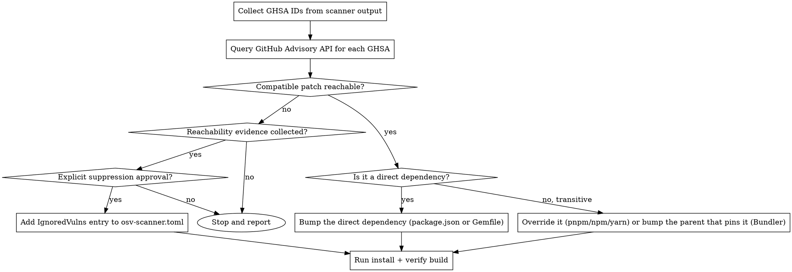

# Fix OSV Vulnerabilities

## Overview

For each reported GHSA, check if a patched version exists via the GitHub Advisory API.
If a patch exists → upgrade via package manager overrides or direct dependency bump; where the manager has no overrides (Bundler), bump the parent that pins the vulnerable package.
If no compatible reachable patch exists → collect reachability evidence and request a suppression decision.

## Workflow



## Step 1 — Collect the alerts

If the repo has Dependabot enabled, one call gets every open alert with its advisory data already joined — prefer this over scraping scanner output:

```bash
gh api --paginate repos/<owner>/<repo>/dependabot/alerts \
  --jq '.[] | select(.state=="open") | {ghsa: .security_advisory.ghsa_id, pkg: .dependency.package.name, scope: .dependency.scope, severity: .security_advisory.severity, range: .security_vulnerability.vulnerable_version_range, patched: .security_vulnerability.first_patched_version.identifier}'
```

`--paginate` is not optional. Without it the endpoint returns only the first 30 alerts, oldest first, and the result looks like a complete list: 505 open alerts once read as ~110. In a polling loop it is worse than incomplete — every newly filed alert lands on a page you never fetch, so the watch goes silently blind.

To look up a single GHSA (e.g. one that came from `osv-scanner` output):

```bash
gh api advisories/GHSA-XXXX-XXXX \
  --jq '"\(.ghsa_id) [\(.severity)] \(.summary)", (.vulnerabilities[] | "    \(.package.name): affected=\(.vulnerable_version_range)  patched=\(.first_patched_version // "NO PATCH")")'
```

Key field: `first_patched_version` — if present, a safe version exists.

Two shape gotchas that will bite you:

- On the **advisories** endpoint `first_patched_version` is a plain **string**; on the **dependabot/alerts** endpoint it is an **object** with an `.identifier` key. Using the wrong one fails with `expected an object but got: string`.
- One advisory often lists **several** `vulnerabilities` entries — one per affected major line (e.g. `<= 7.29.0 → 7.29.6` and `>= 8.0.0-alpha.0, < 8.0.0-rc.5 → 8.0.0-rc.6`). Pick the entry matching the major you are actually on; do not grab the first one and jump a major.

Do not pipe `curl` into `python3`/`node` to parse this — the `dangerous-command-guard` hook blocks piping downloaded content into an interpreter. `gh api --jq` avoids the problem entirely.

## Step 2a — Patch available: apply upgrade

### Transitive dependency (pnpm)

Add or update `overrides` in **`pnpm-workspace.yaml`** at the repo root — not `package.json`:

```yaml
overrides:
  "@babel/core": "^7.29.6" # GHSA-XXXX-XXXX
  package-name: "^<patched-version>" # GHSA-YYYY-YYYY
```

Current pnpm **ignores the `pnpm` field in `package.json`** and only warns:

```log
[WARN] The "pnpm" field in package.json is no longer read by pnpm.
The following keys were ignored: "pnpm.overrides". See https://pnpm.io/settings
```

That warning is easy to miss in install output, and the install then "succeeds" having changed nothing — always confirm the resolved versions (below) rather than trusting a clean exit code.
Verified on pnpm 11.13.0 (2026-07-19); older pnpm 9/10 did read `pnpm.overrides` from `package.json`, so check `pnpm --version` if a repo still uses the old layout.

Annotate each entry with its GHSA id so a future reader knows when the override can be dropped.

Use `^<patched-version>` so pnpm resolves to the latest compatible patch — often ends up installing a newer safe release.
Note that for `0.x` packages `^0.28.1` means `>=0.28.1 <0.29.0`, which is still the right choice.

For npm: use `"overrides"` in `package.json` (npm 8+).
For yarn: use `"resolutions"` in `package.json`.

### Several majors of the same package

One "highest patched version" per package name is wrong whenever the tree holds several majors of that package — the override either drags old consumers across a breaking boundary, or hides a reachable fix behind an unreachable one.
Match each advisory's `vulnerable_version_range` against the versions **actually installed**, and take the highest patch within each installed major.

- **Write one entry per major, never a merged one.** pnpm and yarn berry accept major-scoped selectors: `minimatch@3: ^3.1.4` _and_ `minimatch@9: ^9.0.7`. A blanket `undici: ^6.27.0` once silently downgraded a pinned `undici@7.28.0`.
- **A yarn berry selector names the descriptor the parent requested, so an exact pin needs an exact key.** Read the requesting line in `yarn.lock` (`release-it` lists `undici: "npm:7.29.1"`) and write `"undici@npm:7.29.1": "npm:^7.30.1"`. Such a key stops matching when the parent moves its pin: the same `package.json` still carried `"undici@npm:7.24.5": "^7.28.0"`, which no lockfile line requested any more, so it did nothing. After the install, load the package from the parent's own resolution path, as the boundary rule below describes (react-native-step-counter, GHSA-xjj6-f33q-929c, 2026-10-24).
- **The inverse bites too.** Keeping only the maximum patched version can discard the actionable fix: `fast-xml-parser` had advisories patched at 4.5.4/4.5.5 (reachable from the installed 4.5.3) plus one whose only fix is 5.7.0. Because the `< 5.7.0` range also matches 4.5.3, deduping to the max threw away the reachable 4.x fixes and four alerts stayed open until the override was scoped to `fast-xml-parser@4`.
- **Yarn classic (v1) does support scoped overrides** — the key is the literal dependency chain from `yarn why <pkg>`, e.g. `"glob/minimatch/brace-expansion": "^2.1.3"`. A flat unscoped key is dangerous here because yarn classic merges every semver request for that name into one resolution. The tell is a single lockfile stanza carrying combined ranges (`^1.1.17, ^2.0.2, ^5.0.5`) — that means the override leaked across majors, so revert and re-scope.
- **Preserve the lockfile by default.** An incremental install after editing `resolutions` can leave a stale stanza untouched. Do not delete or replace the lockfile during routine triage. A fresh regeneration can change unrelated resolutions. Require explicit approval before an isolated fresh regeneration in a clean worktree.
- **When two majors have incompatible export shapes, do not force one onto the other.** `brace-expansion` 2.x is `module.exports = expandTop` while 5.x is `{ expand }`. If no compatible reachable patch exists, continue to Step 2b. Do not add an `[[IgnoredVulns]]` entry before collecting the required evidence and obtaining explicit approval.
- **Below 1.0.0 the boundary is the minor, and below 0.1.0 the patch.** `^0.4.2` admits `< 0.5.0`, so an advisory whose only fix is `0.5.0` is a boundary crossing, not a patch bump — the same class of move as 4.x → 5.x, however small the numbers look. Triage that compares majors alone reads it as mechanical and hands you a breaking override: `decode-uri-component` `<= 0.4.2` patched at `0.5.0` was classified `patch-in-major` because both majors are 0, and the resulting resolution forced the ESM-only 0.5.0 onto `query-string@7.1.3`, which is CommonJS and does `require('decode-uri-component')` on line 3 (receipt-scraper PR #9, 2026-09-05, caught as a P1 by hosted review and reverted). Compare the line a caret actually stops at, not the major.
- **When you do force a version across a boundary, prove the consumer can load it — resolving is not loading.** Read the target's `package.json` for `"type"` and its `exports` map, then load it from the consumer's own resolution path with `require` for CommonJS or `import()` for ESM, and call what the consumer calls. `uuid` 7 → 11 in receipt-evidence looked like the same four-major jump, but `uuid@11.1.1` keeps a `require` condition pointing at a CommonJS build, and the probe from `xcode@3.0.1`'s directory resolved `uuid@11.1.1/dist/cjs/index.js` with `v1`/`v3`/`v4`/`v5` all functions and `v4()` returning a valid identifier. Same shape, opposite verdict — which is why the probe decides it and a version comparison does not. In pnpm the consumer's path is `node_modules/.pnpm/<consumer>@<version>/node_modules/<consumer>`; requiring from the workspace root resolves nothing.

Verify per major, without truncation: re-run `yarn why` / `pnpm why` and diff the lockfile for each major line.

Use the package manager's normal install only when an approved dependency change needs a lockfile update.
Treat a fresh regeneration from no lockfile as a separate operation that requires explicit approval.

### Direct dependency

Bump the version in the relevant workspace `package.json` directly:

```json
"devDependencies": {
  "vite": "^7.3.2"
}
```

A gem declared in a Gemfile follows the Bundler section below.

### Bundler: direct and transitive gems

Bundler has no overrides, so a gem moves only as far as every requirement on it allows: the Gemfile's, if the gem is declared there, and each parent's in `Gemfile.lock`, where a parent's requirement is the indented line under the parent's own entry (`rubyzip (>= 2.0.0, < 3.0.0)` under `fastlane (2.238.0)`).
The resolver intersects them, so one requirement that excludes the patch blocks it however many others admit it.
List them all before deciding anything:

```bash
awk '/^    [^ ]/{p=$1} /^      <gem>( |$)/{print p": "$0}' Gemfile.lock   # every parent and its requirement
grep -rn --include=Gemfile --include='*.gemspec' --exclude-dir=vendor '<gem>' .   # a direct declaration, if any
```

A Gemfile that says `gemspec` takes its direct dependencies from the `.gemspec` (`add_dependency`), and the lockfile then lists the local gem itself as a parent; that requirement is edited in the gemspec, not looked up on rubygems.org.

One requirement per parent is normal, not the rule: `faraday` had eight parents in a fastlane-only lockfile.
A Gemfile constraint that excludes the patch is a direct-dependency bump: edit it.
For each parent whose requirement excludes the patch, find the first release of that parent whose requirement admits it, or that no longer depends on the gem at all.
The lookup below is for parents listed in `Gemfile.lock` under a `GEM` section with `remote: https://rubygems.org/`; a parent under `GIT`, `PATH` or another `remote:` is a shape this procedure does not name, so handle it as the closing paragraph says rather than querying rubygems.org, which knows nothing about that source.
List every stable release oldest first, then query each one above the locked version until the requirement changes:

```bash
gh api -X GET https://rubygems.org/api/v1/versions/<parent>.json --jq '[.[] | select(.prerelease | not) | .number] | reverse | .[]'
gh api -X GET https://rubygems.org/api/v2/rubygems/<parent>/versions/<version>.json \
  --jq '.ruby_version, (.dependencies.runtime[] | select(.name=="<gem>") | .requirements)'
```

The second query prints the release's `ruby_version` first (an empty line when the release sets none, as `rake` 0.8.7 does), then one line per runtime requirement on the gem.
A release that prints only that first line no longer depends on the gem: it is a fix, not a gap in the data, because it removes this parent's path to the gem.
Do not cut the list short: the endpoint returns every release (570 stable ones for `fastlane` on 2026-09-30), and the transition can sit anywhere above the locked version.
Keep reading past the first release that admits the patch or drops the gem, because a later one can tighten the requirement again or depend on the gem again, and the release you finally resolve to is the one that has to admit the patch or not depend on the gem.

GHSA-47m2-wp7j-p9vc (`rubyzip < 3.4.0`) was held by `fastlane` 2.238.0 and 2.239.0 at `< 3.0.0`; `fastlane` 2.240.0 raised its own requirement to `>= 3.4.0, < 4.0.0`, so the fix was a parent bump with no Gemfile edit.
If any blocking parent has no release that admits the patch or drops the gem, continue to Step 2b.

Update the vulnerable gem and every blocking parent in one resolve, without installing:

```bash
BUNDLE_GEMFILE=/abs/path/Gemfile bundle lock --update <gem> <each blocking parent> --conservative
```

Name the gem even when a parent bump seems enough. `--conservative` holds every gem not on the command line at its locked version unless a requirement forces it off, so a parent whose new requirement admits the patch but still admits the locked vulnerable version (`>= 2.0.0, < 4.0.0` instead of `>= 3.4.0`) leaves the gem where it is.
The fastlane case needed only the parent because 2.240.0 forced `rubyzip` off 2.4.1; do not rely on that.
Name it also when every blocking parent dropped it: the gem is still in the lockfile when the command starts, and the resolve removes it once no requirement reaches it, while a Gemfile declaration or a parent that still depends on it keeps it in the bundle at whatever version its requirements allow.

Every gem named on the command line moves to the newest release its requirements admit, not to the release you selected: `--update` defaults to `--major` (the fastlane case landed on 2.240.1, not 2.240.0, and `rubyzip` on 3.7.0, not 3.4.0).
Read which versions the lockfile now names for each gem you named, and check those releases.
Where one went further than you want, narrow that gem's own constraint in the Gemfile before running the command (`gem "fastlane", "~> 2.240.0"`; for a transitive gem, declaring it there makes it direct).
Do not reach for `--patch` or `--minor` with `--strict` instead: the level applies to every named gem at once, and the gem and its parent usually need different levels (`--minor --strict` would have blocked the required `rubyzip` 2.x → 3.x move).
If the Gemfile's own constraint on a parent excludes the release it needs, edit that constraint too.

This is a triage procedure, not a model of Bundler's resolver.
When the lockfile shows a shape it does not name, resolve with Bundler itself (`bundle lock --update … --print` shows the result without writing it) and report what it chose, rather than extending this list.

- **Every lockfile is a separate alert and a separate fix.** A mobile app can carry one Gemfile per platform (`android/Gemfile` and `ios/Gemfile`, each only for fastlane), so the same GHSA arrives twice. Update each; compare the two lockfiles afterwards, since they should differ only where the Gemfiles do.
- **Read the diff for what else moved.** A parent bump carries its other requirement changes with it (the fastlane bump above also added `cgi` and moved `security` 0.1.5 → 0.3.0, which is a boundary crossing under the 0.x rule above).
- **Check the Ruby floor.** Compare the `ruby_version` of every gem the lockfile moved against each place that picks the Ruby: `.ruby-version`, a `RUBY VERSION` section in the lockfile, and `ruby-version` in any CI workflow that runs the tool.
- **Confirm a dropped gem is gone.** Where every path to the gem was dropped, both `grep -n '^    <gem> (' <each Gemfile.lock>` and `grep -nE '^      <gem>( |$)' <each Gemfile.lock>` print nothing. If either prints, a path still reaches the gem, so the version the lockfile names has to be patched, which the next bullet checks. With the gem out of the bundle there is nothing to load, but code that used it without declaring it now fails: at its `require`, or, where the parent loaded the gem for it, at the first constant it names (`Zip::File` in a Fastfile). Search the whole project for the gem's name as a whole word in any case, rather than for a call shape, a quoting style or a file type: a call can span lines (`require(` then `"zip"`), go through `autoload`, or spell the path as `%q(zip)` or a symbol, and Ruby also loads from a `Rakefile`, `.rake` tasks, a `Podfile`, a `Fastfile` and extensionless scripts under `bin/` (`grep -rnwi zip --exclude-dir=vendor --exclude-dir=.git --exclude-dir=node_modules .` for `rubyzip`, which matches `zip/filesystem` and `Zip::File` and skips `gzip`). Read each hit, since the same word can appear for another reason. The search is a lead, not a proof: an empty result still misses a path or a constant the code computes at runtime, so the proof is running the paths that used the gem, and the next bullet's rule for paths that cannot be run applies.
- **Load it, then say what did not run.** After `bundle install`, confirm the resolved version with `grep -n '^    <gem> (' <each Gemfile.lock>` and load it through the bundle by the path its consumers require, which need not be the gem name (`BUNDLE_GEMFILE=… bundle exec ruby -e 'require "zip"'` for `rubyzip`; 2.x ships no `rubyzip.rb`, so `require "rubyzip"` is a `LoadError` there and loads only from 3.x). `fastlane lanes` proves only that the Fastfile parses; the actions that use the moved gem (uploads, archive handling, keychain access) run only in a real lane, which has external impact, so report them as unexercised instead of running one.

### Apply and verify

```bash
pnpm install --no-frozen-lockfile   # Changing overrides is a lockfile config change
pnpm build                          # Confirm build passes
```

`--no-frozen-lockfile` is required: with `CI=true` (or on CI) a plain `pnpm install` aborts with `ERR_PNPM_LOCKFILE_CONFIG_MISMATCH` because the new `overrides` block does not match the one recorded in the lockfile.
Prefixing `CI=true` also avoids `ERR_PNPM_ABORTED_REMOVE_MODULES_DIR_NO_TTY` when pnpm wants to purge `node_modules` in a non-interactive shell.

Confirm the resolved versions are ≥ the patched versions — this is the real proof the fix landed, not the install exit code:

```bash
pnpm why <pkg-a> <pkg-b> --depth 1
```

Watch the `Found N versions of <pkg>` line: an override that worked usually collapses a package to a **single** version by pulling a parent off its exact pin.

Map each override to a check that actually executes it, rather than assuming `pnpm build` covers everything:

| Override lives in                    | Exercised by                                    |
| ------------------------------------ | ----------------------------------------------- |
| CSS pipeline (postcss, autoprefixer) | `pnpm build`                                    |
| Lint/AST tooling (`@babel/core`)     | `pnpm lint` — a Next build uses SWC, not Babel  |
| Script runner (`esbuild` via tsx)    | the test/script command that runs through `tsx` |

Gotcha: `trunk check`'s osv-scanner cache can report a false green after edits — `touch` the lockfiles to bust the cache before trusting a clean run (Dependabot is the independent oracle when in doubt, but not for a pnpm lockfile with an env document first; see "Retiring an override").

To make that green fail first on the pre-fix tree, pass `--show-existing` and read the output, not the exit code.
Trunk holds the line against upstream, so a vulnerability already on the base branch is an "existing issue": in a worktree of the pre-fix commit, `trunk check --no-fix --filter=osv-scanner Gemfile.lock` printed `1 existing issue` and `✔ No new issues` and exited 0; only `--show-existing` printed the GHSA line, and that run exited 0 too.
Pin the pre-fix tree by SHA (`git worktree add --detach <dir> <sha>`), never `HEAD`: a parallel commit can move `HEAD` past the fix between two commands, and a "pre-fix" copy taken from it is already fixed and scans clean for the right reason.

## Step 2b — No compatible reachable patch: request a suppression decision

Find the osv-scanner config file — osv-scanner auto-discovers config ADJACENT to the scanned lockfile, so placement matters:

- Check for an `osv-scanner.toml` next to the lockfile that produced the finding first (e.g. `example/osv-scanner.toml` for `example/Gemfile.lock` — a root or `.trunk/configs` copy will NOT be picked up for that lockfile)
- Then `osv-scanner.toml` in the project root
- Fall back to `.trunk/configs/osv-scanner.toml`

Do not add an `[[IgnoredVulns]]` entry by default.
First collect reachability evidence for the installed package and each affected usage.
Then obtain explicit approval for the suppression.
The approval must name the GHSA and the affected package version.

The evidence is about what ships, not only about the dependency path.
Build the artifact that the deploy or publish workflow ships and prove what it includes.
A minified bundle drops package names and import paths, so an empty grep for the package name is not evidence of absence, and an unrelated control string only proves that the files were read.
Absence needs module-level metadata for the shipped build: an esbuild metafile's `inputs`, or the `sources` of the source maps that ship with each chunk. A Vite `manifest.json` lists entry points and output chunks, and a Next.js `.nft.json` lists runtime files to copy; neither lists the modules bundled into a chunk. A server deployment can also ship packages outside the bundle, so check its runtime file list (`.nft.json`, the deployed `node_modules`) as well.
A literal from inside the package that survives minification, such as an error message (`exceeds maximum allowed length` for picomatch), can show that the package is included, but tree shaking can drop the branch that holds it while keeping the rest. Without module-level metadata, an empty result is inconclusive, not absence: decide from the dependency path instead, or ask.
A server that installs `node_modules` instead of shipping a bundle (Firebase Functions, a Docker image) ships every production dependency, so there a non-empty `pnpm why <pkg> --prod` or `npm ls <pkg> --omit=dev` is the verdict.
A Next.js build lists `next/dist/compiled/picomatch` in `.next/next-server.js.nft.json`: that is Next's own vendored copy, used for `images` patterns from `next.config`, not the lockfile package that the alert tracks, and no scanner reads it. Exclude that path and judge the remaining hits.

After approval, append an `[[IgnoredVulns]]` entry that records the evidence, date, reason, and reevaluation owner:

```toml
[[IgnoredVulns]]
id = "GHSA-XXXX-XXXX"
reason = "<package>@<version> has no compatible reachable patch as of <YYYY-MM-DD>. Reachability evidence: <command and result>. Approved by <name> on <YYYY-MM-DD>. Re-evaluation owner: <name or team> checks when a compatible patch is released."
```

Do not suppress a reachable vulnerability because it is inconvenient to update.

## Cleanup

Once an override is in place, remove any `[[IgnoredVulns]]` entries for the same GHSA that are no longer needed.

If an override was previously set to pin an older version for a GHSA that was "no patch available" at the time, update both the override and remove the ignore entry.

### Retiring an override

Remove an override only when the graph without it stays outside every advisory the override cites.
Do not decide from these signals, because each one can say "resolved" or "unused" while the override still blocks a vulnerable version:

- A Dependabot alert in the fixed state. A pnpm 12 lockfile with an env document first hides the project graph from GitHub; `manage-dependabot` owns that check.
- A repository guard or script that reports "no edges", "unused", or "not installed" for an override. Make it fail on a known-needed override before you trust it. A guard that reads the first `snapshots:` block of a multi-document pnpm lockfile reads pnpm's own install graph.
- An earlier `trunk check` green, which can come from the osv-scanner cache (see the gotcha above).

For each candidate override:

1. In a scratch worktree, delete the override and run `pnpm install --lockfile-only --no-frozen-lockfile` (or the manager's equivalent).
2. List the versions that the lockfile diff adds for the overridden package.
3. Read each cited GHSA with `gh api /advisories/<GHSA> --jq '.vulnerabilities[] | "\(.package.name) \(.vulnerable_version_range)"'`.
4. Keep the override if any added version is inside any range. Otherwise delete it in the real tree, regenerate the lockfile there with the same command, check that the frozen install passes, then run osv-scanner with `--show-existing` on the full lockfile and confirm no finding for that package.

turbo-flutter-log, 2026-11-17: the repository guard reported all 16 consumer-scoped overrides as unused and Dependabot showed no open alerts. Without the overrides the lockfile resolved minimatch 9 and 10, glob 10 and 13, diff 7 and serialize-javascript 6, each inside its cited range. In the same repository, the MSAL override was correctly retired, because its parent resolved msal-node 7.2.2 outside GHSA-xcx6-jx8p-x3h5.

### Withdrawn advisories

An ignore entry for a withdrawn advisory suppresses nothing, because osv-scanner stops matching the advisory and its Dependabot alert URL answers HTTP 410.
Read `gh api advisories/<GHSA> --jq .withdrawn_at` for every GHSA that an `[[IgnoredVulns]]` entry, a `[[PackageOverrides]]` entry or an override comment cites.
Delete each `[[IgnoredVulns]]` entry whose advisory is withdrawn, together with any comment that described only it, then confirm that `--show-existing` still reports nothing for that package.
A `[[PackageOverrides]]` entry applies to the whole package version, not to one GHSA, so remove it only after a `--show-existing` scan with the entry moved aside, and the lockfile touched first so the osv-scanner cache cannot answer, reports no finding for that package.
A dependency override that cites a withdrawn advisory, alone or beside an active one, stays until the re-resolve check above shows that the versions added without it are outside every active advisory's range, including advisories the override does not cite.
On 2026-11-18, GHSA-gcqx-w48m-w2h4 (deepmerge), GHSA-vfj7-8cjw-p6xm (braces) and GHSA-hp3w-g68c-fv3c (sprintf-js) had been withdrawn for days to weeks while ignore entries for them remained in eight repositories.

## Many repositories at once

- **Find the targets from lockfiles, not only from open alerts.** Dependabot dismisses a development-scope alert automatically when it creates it (`state: auto_dismissed`), and an alert can be missing for a day after the advisory's `github_reviewed_at`. Query alerts in every state, and also scan each checkout's tracked lockfiles (`git ls-files`). In the 2026-11-18 picomatch sweep, open alerts named 8 repositories and the lockfile scan found 8 more, three of them with an `auto_dismissed` alert.
- **Let subagents collect evidence, and write the suppression and dismiss the alert in the coordinating session.** The auto mode classifier refused a subagent's `osv-scanner.toml` suppression edit as "Undermining Oversight", and a subagent's dismiss, because the approval reached the subagent only through its brief. Override removals that a subagent verified and pushed were not refused. Have each subagent report the config path, the exact entry text, the lockfile to scan and the dismiss comment.
- **Read each repository's state before you push.** Run `git fetch` right before the push, then read `git log --format='%h %an %ad %s' origin/main..main` and confirm that every listed commit is one you made for this push; a count can match while a different commit sits in the range, and a push publishes all of them, as happened once in that sweep. A ruleset that rejects a direct push, or a repository frozen for an external review, is a reason to stop and ask, not to switch to a PR on your own: one PR opened that way had to be closed unmerged.

## Common Mistakes

| Mistake                                                   | Fix                                                                                               |
| --------------------------------------------------------- | ------------------------------------------------------------------------------------------------- |
| Putting pnpm `overrides` in `package.json`                | Current pnpm only reads them from `pnpm-workspace.yaml` — it warns, then silently changes nothing |
| Trusting a clean `pnpm install` exit code                 | Verify with `pnpm why <pkg> --depth 1` that the resolved version is ≥ patched                     |
| Assuming the lock file auto-updates                       | Always run `pnpm install --no-frozen-lockfile` after editing overrides                            |
| Setting override to exact version (`"3.1.4"`)             | Use `"^3.1.4"` — lets pnpm pick latest safe patch                                                 |
| Adding `IgnoredVulns` before reachability evidence        | Collect the dependency path and affected usage first, then obtain explicit approval               |
| Fresh-regenerating a lockfile without approval            | Preserve it by default; use an approved isolated regeneration only when needed                    |
| Leaving stale `[[IgnoredVulns]]` after patching           | Remove the entry when upgrading the override                                                      |
| Checking latest published version instead of advisory     | Use the GitHub Advisory API — npm dist-tags don't encode CVE fix info                             |
| Taking the first `vulnerabilities[]` entry in an advisory | Multiple entries = multiple major lines; match the major you are on                               |
| Assuming `pnpm build` validates every override            | Lint/script-only deps need `pnpm lint` / the `tsx` command to be exercised                        |
| One override per package name when several majors exist   | Scope per major (`minimatch@3` and `minimatch@9`); a merged key downgrades or breaks a consumer   |
| Deduping advisories to the highest patched version        | The unreachable fix hides the reachable one — scope to the installed major                        |
| Listing Dependabot alerts without `--paginate`            | Truncates at 30, oldest first, and reads as a complete list                                       |
| Removing an override because a guard or alert says unused | Re-resolve without it and compare against the advisory ranges ("Retiring an override")            |
| Keeping an ignore entry for a withdrawn advisory          | Read `withdrawn_at`; the entry suppresses nothing, so delete it ("Withdrawn advisories")          |
| Choosing sweep targets from open alerts only              | Development-scope alerts are `auto_dismissed`; scan tracked lockfiles too                         |

## Provenance

The multi-major scoping section began as a standing rule and was folded in here instead: it only ever fires during the dependency triage this skill already owns, so as an always-loaded rule it spent context in every session to be useful in a few.
The cases behind it were real ones — an `undici` downgrade that resolved to an unreachable major, `minimatch` present at both 3 and 9 in one tree alongside `ajv`, `path-to-regexp`, `brace-expansion`, `body-parser`, `picomatch` and `form-data` in the same shape, and yarn-classic nested paths that the flat override never reached.
